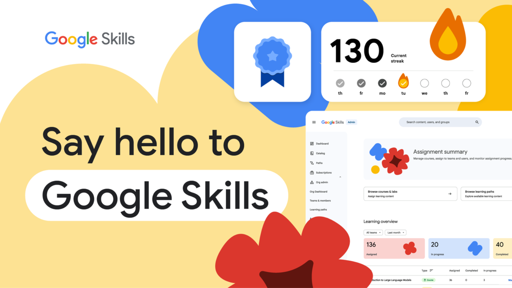

# Google Cloud Labs




Automation scripts for Google Cloud Skills Boost Challenge Labs.

## Overview

Automation scripts for Google Cloud Skills Boost Challenge Labs. Each script
prompts for the lab-specific variables, validates input, and executes the
required `gcloud` commands in sequence. The goal is to reduce repetitive
setup work while keeping the process transparent — read the code before
running it.

Every script follows the same pattern:
1. Prompt for lab variables (with validation)
2. Enable required APIs if needed
3. Execute tasks with progress logging
4. Output results at each step

## Available Labs

| Code | Lab | What It Covers |
|------|-----|----------------|
| [GSP327](gsp327/) | Engineer Data for Predictive Modeling with BigQuery ML | Building ML models for taxi fare prediction using BigQuery ML and feature engineering |
| [GSP338](gsp338/) | Monitor and Log with Google Cloud Observability | Setting up custom metrics, log-based metrics, and alerts for monitoring services |
| [GSP341](gsp341/) | Create ML Models with BigQuery ML | Creating classification models to predict customer behavior using logistic regression |
| [GSP342](gsp342/) | Implement Cloud Security Fundamentals | Building secure GKE private clusters with custom IAM roles and service accounts |
| [GSP345](gsp345/) | Build Infrastructure with Terraform | Managing GCP infrastructure as code with Terraform modules and remote state |

## How to Use

Pick whichever method works for you:

**Clone and Run Locally**
```bash
git clone https://github.com/dapovoa/gcp-labs.git
cd gcp-labs/gsp327
bash solution.sh
```

**Quick One-Liner**
```bash
curl -L https://raw.githubusercontent.com/dapovoa/gcp-labs/main/gsp327/solution.sh -o solution.sh && chmod +x solution.sh && ./solution.sh
```

**Run Without Saving**
```bash
bash <(curl -s https://raw.githubusercontent.com/dapovoa/gcp-labs/main/gsp327/solution.sh)
```

## Repository Structure

```
gcp-labs/
  gsp327/
    README.md
    solution.sh
  gsp338/
    README.md
    solution.sh
  gsp341/
    README.md
    solution.sh
  gsp342/
    README.md
    solution.sh
  gsp345/
    README.md
    solution.sh
```

## Prerequisites

- An active GCP project
- gcloud CLI installed and authenticated
- IAM permissions for the resources the lab creates
- Lab instructions open (for the required variable values)

## Tech Stack

- BigQuery / BigQuery ML
- GKE
- Cloud Monitoring / Logging
- Terraform
- Bash

## Cost and Cleanup

These scripts create real GCP resources. Review what each script does before
running it, and clean up resources after completing the lab to avoid
unexpected costs. These scripts are intended for learning, not production use.

## License

This project is under the MIT License. See the [LICENSE](LICENSE) file for details.
